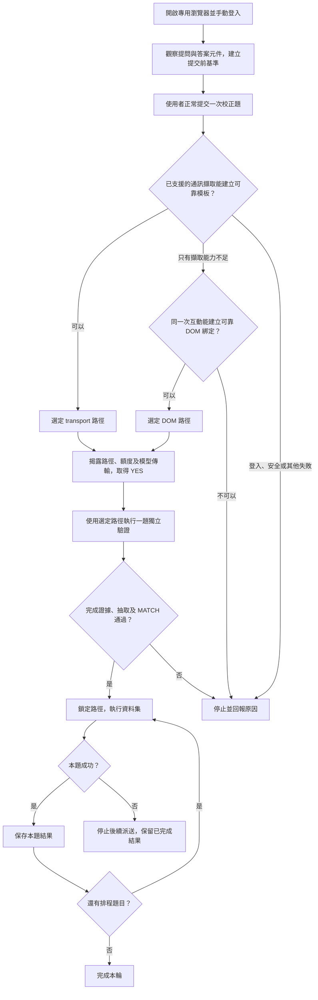

# PRD：校正階段選路與 DOM／可存取性 fallback

## 狀態與規格關係

- 日期：2026-10-09。
- 狀態：已依使用者確認的兩個公開測試邊界實作；支援範圍及驗收證據見末節。
- 入口沿用 `lladar run-agent DATASET --page-url URL`。
- 本文件補充並修訂 [browser mode 主 PRD](PRD-browser-captured-api-evaluation.zh-TW.md) 的執行路徑選擇與 rendered-answer 擷取範圍。
- 主 PRD 的直接模型抽取、登入方式、YES／MATCH、請求額度、敏感資料處理、三欄輸出與評分職責持續適用。
- 本文件與主 PRD 對路徑選擇有衝突時，以本文件為準；其餘契約仍由主 PRD 定義。

## 問題與實測依據

目前 browser mode 能擷取 HTTP fetch/XHR、GraphQL-over-HTTP、SSE，以及每題正常關閉的原生文字 WebSocket。這是通訊擷取能力，不保證任意網頁都可用。

[原生 Streamlit 1.65.0 實測](streamlit-browser-validation.zh-TW.md)顯示：網頁能正常問答，但使用二進位、持續開啟的 WebSocket，現有 `--page-url` 校正擷取逾時。此測試是已觀察的能力邊界，不代表所有 Streamlit 版本或所有網站都具有同一行為。

僅增加長連線支援仍無法解決二進位編碼、session／widget 狀態及每題回答關聯。對只提供正常問答網頁的使用者，增加 DOM／可存取性操作可沿用網站自己的提交與通訊流程，減少對內部協定的依賴。

## 已確認決策

1. 只在校正階段選擇可用路徑。
2. 優先沿用已支援的通訊擷取；能力不足時，評估 DOM／可存取性路徑。
3. DOM 路徑操作真實輸入、送出元件，讀取本題答案文字；不用截圖或 OCR。
4. 獨立驗證及資料集執行固定使用同一路徑；任何失敗都停止派送，不自動換路徑或重送同題。
5. 保留現有每題正常關閉的文字 WebSocket 支援；本版不新增長連線重播，不要求網站改用短連線。
6. DOM 操作時由網站自行管理 HTTP、SSE、短連線或長連線，LLaDAR 不解析不支援的內部協定。
7. 網頁內部元件方法、私有 framework 狀態與協定適配不作為本版第三條路徑。

## 目標與非目標

目標是讓具有可定位提問元件、可完整讀取回答、且能觀察回答完成狀態的問答網頁，在通訊擷取不可用時仍可進行 browser mode 評估。

本版不保證支援所有網站。不實作影像辨識、座標點擊、Canvas 答案解析、框架私有狀態修改、二進位協定解碼、Socket.IO 或任意 JavaScript／parser 生成。也不修改目標網站原始碼、不增加目標 HTTP API、不變更專案模式與 `--service-url`。

## 使用者流程



- 觀察元件及建立 DOM 基準需在校正題提交前開始，不等通訊逾時後才猜哪一則是新答案。
- 通訊擷取與 DOM 觀察可使用同一次人工校正互動；觀察不得自動送出第二題。
- 使用者仍自行處理登入、OTP／MFA、CAPTCHA 與帳號選擇。
- 系統自動尋找可用元件；候選不唯一時，可請使用者在可見頁面指出或選擇元件，不要求提供 CSS selector、API schema 或解析程式。
- 若同次校正缺少必要的提交前觀察，應停止並提示重新校正；不得靜默提交一題補足證據。
- 揭露選定路徑後，沿用一次 YES 與獨立 MATCH 流程，不新增路徑旗標或互動模式選擇。

## 路徑選擇規則

HTTP／REST、SSE 與 WebSocket 都屬於 `transport` 路徑。短／長連線是通訊生命週期，不是額外的獨立路徑。

| 校正結果 | 行為 |
| --- | --- |
| 找到唯一問句位置、對應完整回應與可重播模板 | 使用 transport，維持現有驗證流程 |
| 可見 UI 已完成回答，但無可支援的通訊模板或回應擷取方式 | 評估同次互動的 DOM 證據 |
| 二進位或長連線超出已支援範圍，但 DOM 證據可靠 | 可選 DOM，不解析該協定 |
| 無法證明 UI 回答已完成，或候選題目／答案不唯一 | 停止，要求最小補充或回報不支援 |
| 登入失效、權限錯誤、敏感資料、擷取超限、傳輸故障或來源不明 | 停止，不藉 DOM 繞過失敗 |
| 缺少傳輸同意、模型錯誤、抽取歧義或 MATCH 不符 | 停止，不換路徑 |
| 獨立驗證或任一資料集試跑失敗 | 停止後續派送，不換路徑、不重試 |

只有宿主能判定的擷取能力不足，才可進入 DOM 評估。一般逾時或網路錯誤本身不足以證明需要 fallback。即使可見答案存在，也不得繞過登入、來源關聯、安全限制或抽取驗證。

能提早確認不支援的通訊方式時應提早評估 DOM；不必等預設 3600 秒。仍在進行的回答則沿用回答等待期限，不能把等待期間當成失敗後重新提交。

## DOM 綁定與實際操作

校正需建立並驗證以下綁定：

| 綁定 | 要求 |
| --- | --- |
| 提問元件 | 唯一、可編輯，能接收完整 Unicode 問句 |
| 提交動作 | 唯一的送出按鈕或經校正的鍵盤動作，每題最多觸發一次 |
| 本題關聯 | 能區分本次使用者訊息、對應回答及校正前既有對話 |
| 回答範圍 | 本次回答的完整文字區域，保留段落、換行與區塊順序 |
| 完成條件 | 經校正並於獨立驗證重現的可信 UI 狀態轉移或明確完成標記 |
| 工作階段 | 原登入頁面與既有會話；必要的頁面或 frame 範圍須明確綁定 |

優先使用 role、accessible name、label 或明確 test ID。只有可驗證的穩定 DOM 屬性才可作備選，不依賴一次性的 class、座標或深層位置索引。跨 rerender 重新解析定位器，但不得在正式執行時重新探索另一組元件。

填寫與提交必須使用瀏覽器元件的正常操作，讓網站原本的驗證、事件與 session 流程執行。不得直接修改 DOM 文字假裝網站已回答，也不得直接寫入框架私有狀態或猜測內部函式。

DOM 綁定僅描述操作與觀察位置，不是答案欄位解析 DSL，也不授權模型產生或執行任意腳本。

## 本題答案關聯與完成證據

- 每次提交前記錄既有對話及元件狀態的必要基準；提交後建立新的宿主 request identity。
- 即使驗證題與校正題文字相同，也須以本次新互動的證據區分，不能靠答案字串或問句文字作唯一識別。
- 回答 append、原區域 replacement 或多個答案區塊都需有可驗證的本題關聯。找不到唯一關聯就停止。
- 不得只讀取頁面的最後一則訊息、整頁 `innerText`，或全部歷史回答。
- 完成證據可來自與本題綁定的生成中→完成狀態、停止按鈕→可再次提交狀態、busy→idle，或明確完成指示。單一「輸入框可用」只有在校正已證明其與本題完成相關時才有效。
- 只看到答案文字、字數不再變動、固定 sleep、一段時間沒有訊息或 DOM 沒再改變，都不能單獨判定完成。
- 本題有可信正常完成證據後，才擷取其完整文字；拒答、錯誤說明或不確定答案可作目標原有回答，依既有抽取契約處理。
- 沒有可靠完成訊號、回答被虛擬化而無法完整讀取、關聯不明、登入失效或頁面離開原範圍時停止，不接受部分答案。
- 系統不得僅因網頁能顯示答案就宣稱該網站已支援 DOM 評估。

## 直接模型抽取與資料範圍

兩種路徑的差異是取得材料的方法；答案抽取仍只有既有的直接模型途徑，不加入「DOM 無模型捷徑」。

DOM 路徑提供本題完整回答文字與必要的區塊順序，以宿主認可的文字／JSON envelope 交給既有抽取模組。完成證據、request identity 與來源綁定由宿主管理，不交由模型猜測。模型不得生成回答、修正目標內容或利用 expected_answer。

不傳整頁 HTML、其他對話、表單值、Cookie、headers、登入資訊或 framework 狀態。元件探索只使用必要的頁面結構與標籤；若日後需要額外模型來探索元件，其資料傳輸、呼叫額度及執行權限須另有明確設計，不由本 PRD 自動授權。

擷取沿用 1 MiB 上限，模型輸入沿用含封裝的 120 KiB；超限不截斷、不摘要、不拆成多次呼叫。主 PRD 的敏感內容篩檢與固定輸出限制持續適用。

## 正式執行、會話與失敗處理

- 在獨立驗證前確定路徑；驗證成功後凍結路徑與元件綁定。驗證失敗後不再評估另一條路徑。
- 每題只提交一次，依既有排程逐題執行；不並行操作同一頁面。
- 沿用既有登入及目標會話，不默默清空歷史或重建目標 session。目標會話的連續／隔離規則需在校正時說明；不能驗證必要語意時停止。
- 每題等待與抽取仍受 `--timeout` 及整輪剩餘期限約束。等待或進度提示不增加提交次數或模型呼叫。
- 操作失敗時，即使尚不確定網站是否收到問句，也不得自動重送。紀錄提交未嘗試、已嘗試或結果不明的安全狀態。
- 第一個正式失敗立即停止後續網站派送。已完成的 responses 保留；失敗與剩餘未派送 trial 以既有 evidence 契約標示，不寫入假的空白或部分 `actual_response`。
- 不自動重新登入、切換頁面、重新校正、改選 locator、切回 transport 或改用 DOM。
- 使用者重新啟動一輪可重新校正，但本 PRD 不新增自動續跑或去重功能。

## 額度、診斷與 CLI

入口與現有旗標不變，不要求使用者理解通訊協定。校正成功後簡短顯示選定通訊擷取或網頁元件操作，以及該路徑的完成判斷方式。

人工校正觀察不額外派送網站請求。沿用 1 次獨立驗證、N 次排程試跑，以及最多 N+2 次既有模型抽取的揭露；改走 DOM 不增加同題請求或重置額度。若需要更多人工校正操作，必須明示原因，不能變成隱藏的自動探索請求。

安全 evidence 須能分辨：

- 選定路徑：`transport` 或 `dom`。
- 校正、路徑選擇、獨立驗證與資料集執行的失敗階段。
- DOM 綁定版本與完成證據種類；不保存私有 selector 值、頁面內容或狀態快照。
- 本題是否嘗試提交，以及封鎖後的 trial 未提交。
- 首次封鎖原因、等待耗時及可安全量測的材料位元組數。

原因分類至少涵蓋元件不唯一、定位失效、本題關聯失敗、完成未確認、完整文字不可得與既有安全／模型失敗。新分類與 stage 必須由宿主固定定義並在 CLI verbose、`--log`、trial 及 run sidecar 一致輸出，不輸出原始瀏覽器例外。

保留階段進度與等待時間提示；沒有可信進度時不顯示百分比或 ETA。

## 驗收要求

| ID | 案例 | 通過條件 |
| --- | --- | --- |
| DF-01 | 現有 HTTP／SSE／文字 WebSocket 頁面 | 優先選 transport，既有抽取、YES／MATCH 與輸出回歸通過 |
| DF-02 | 原生 Streamlit 問答頁 | 不改二進位協定、不增加 HTTP API；校正選 DOM，獨立驗證及至少兩題實際 UI 問答成功 |
| DF-03 | DOM 完成觀察 | Streamlit／測試頁須具有實測可用的完成訊號；無訊號的頁面明確停止，不以穩定文字替代 |
| DF-04 | 同一次校正互動 | transport 無法擷取後，DOM 使用原互動，伺服器只收到一次校正題 |
| DF-05 | 相同文字與既有歷史 | 校正、驗證或兩題可有相同問句／答案，仍以各自新互動建立正確關聯 |
| DF-06 | 多題與 rerender | 定位器跨正常重新渲染可解析原綁定，答案不混入歷史、上一題或下一題 |
| DF-07 | 串流及多區塊回答 | 完成前不抽取，完成後全文與獨立基準相同，不重複累積快照 |
| DF-08 | 中途提交／定位／登入失敗 | 立即停止後續派送，沒有改路徑或第二次提交，保留先前成功結果 |
| DF-09 | 不明完成或答案不可完整讀取 | 限時停止，不產生部分 `actual_response`，不呼叫模型猜測完成 |
| DF-10 | 模型失敗、MATCH 不符、安全拒絕或超限 | 不觸發 DOM fallback 或額外網站請求，沿用安全失敗契約 |
| DF-11 | 元件候選不唯一 | 要求最小補充或停止，不猜測元件、不要求使用者撰寫 selector |
| DF-12 | 額度、隱私與證據 | 請求數與模型呼叫數符合揭露；模型及一般產物不含整頁、其他對話與憑證 |

DF-02 由新增的整體選路與 DOM 成功案例驗收；原 Streamlit 負向測試仍保留 transport-only driver 的限制驗證，不把負向測試通過當成 DOM 支援證據。

本機 fixture 使用真 Chromium 與真 Streamlit，但可使用合成抽取 provider；這只證明宿主與瀏覽器流程。真模型忠實度及真網站驗收需分別記錄，不混用成果。

## 實作順序與尚待驗證事項

1. 增加校正觀察與 route selection，保持沒有額外提交。
2. 建立 DOM 操作、每題材料綁定及完成證據介面。
3. 接入既有抽取、YES／MATCH、時間／額度及安全 evidence。
4. 以原生 Streamlit 驗證 UI 完成訊號，再完成多題、失敗即停止與既有 transport 回歸。

已實測確認 Streamlit 1.65.0 範例的公開完成訊號、具標準答案容器的 rerender 與具名同源 iframe。沒有可靠完成訊號、沒有可辨識答案容器或缺少穩定 frame 綁定的頁面仍停止；其他頁面支援須另行實測，不以固定 sleep、私有狀態存取或再次提交掩蓋不確定性。


## 本次實作與驗收紀錄

TDD 邊界由使用者明確確認為 `BrowserTarget.prepare／answer` 及 `run-agent --page-url`。新增測試使用真 Chromium、loopback HTTP／WebSocket 伺服器及真 Streamlit 1.65.0；模型、互動終端為外部測試替身。

目前固定 DOM 綁定版本為 1：

- Streamlit 原生 `st.chat_input／st.chat_message`，依公開 test ID 與 `data-test-script-state` running→notRunning 觀察本題完成。
- 一般表單頁須有唯一輸入 placeholder、唯一具名送出按鈕、具 `aria-label／aria-busy` 的唯一 `role=log`，以及 `data-role=user／assistant` 訊息。
- 支援追加對話及具有新 `data-turn-id` 的答案區 replacement；同一問句每次提交仍須產生新的本題證據。
- 支援主頁及具有唯一 name、固定網址的同源 iframe；跨來源、無穩定 frame 綁定、其他未支援頁面結構均停止，不嘗試猜測。

逐一執行 red→green 的切片涵蓋：Streamlit 與表單 DOM 選路、輸入綁定遺失、cookie 回顯阻擋、相同問句的 replacement、Streamlit CLI 產物與安全路徑紀錄、不支援 HTTP 格式退回同次 DOM、持續開啟 WebSocket／SSE、答案範圍歧義、隱藏答案、同源 iframe、二進位 WebSocket 回覆、已知 request token 回顯阻擋、超限二進位材料、缺少新輪次標記的相同答案替換，以及校正後更新 cookie 的回顯阻擋。

補充回歸案例確認：支援的 HTTP 優先於 DOM、無 busy／未回 idle 不接受、401 不被 DOM 掩蓋、正式問答逾時不抽取半成品且不再派送，以及 CLI 保留已完成 responses 並標示後續未送出的 trials。WebSocket transport-only 與 Streamlit 負向案例保留。

不新增 CLI 旗標，不新增目標網站 API，不重設對話，不自動重試或換路徑。安全 sidecar 僅記錄 route、DOM 綁定版本及完成觀察類型，不記錄 selector、DOM、headers、cookies 或私有錯誤。

初期 fixture 驗收只證明上述頁面契約、瀏覽器流程及產物；後續真 Gemini 驗收見末節，仍不宣稱任意網站或所有 Streamlit 版本皆可支援。


最終 DOM／Streamlit 驗收：`24 passed`（431.69 秒）。命令：

```powershell
$env:PYTEST_DISABLE_PLUGIN_AUTOLOAD='1'
uv run --extra test --extra streamlit-test pytest tests/test_dom_browser_target.py tests/test_streamlit_browser.py -m browser -x
```

抽取流程、BrowserTarget、CLI 與 provider 回歸：`95 passed, 1 deselected`。另行執行既有 `test_deadline_kills_dripping_worker_and_does_not_retry` 時，兩秒 deadline 內觀察到零次 HTTP 請求，與 fixture 預期的一次不符，重跑仍失敗；未把該案例計入通過，也未放寬其期限或修改測試。這不構成真模型驗收。


HTTP／SSE／原生文字 WebSocket 與 browser workflow 回歸（含當時的 DOM／Streamlit 案例）：`96 passed`（1067.69 秒）。

```powershell
$env:PYTEST_DISABLE_PLUGIN_AUTOLOAD='1'
uv run --extra test --extra streamlit-test pytest tests/test_dom_browser_target.py tests/test_streamlit_browser.py tests/test_playwright_driver.py tests/test_websocket_driver.py tests/test_browser_workflow.py -m browser -x
```

以上兩輪瀏覽器測試有重疊，不相加計算；最終 DOM／Streamlit 的 24 項覆蓋後續加入的安全防護。`compileall` 與 `git diff --check` 均通過。


## 延長時限與真 Gemini 驗收（2026-10-09）

使用者授權延長測試時間並使用真 Gemini。API 模型清單確認本機帳號支援 `gemini-3.8-flash`；憑證從本機 `.env` 讀取，未輸出或寫入驗收紀錄。

- 既有滴流案例的測試期限從 2 秒改為 10 秒，讓 Windows worker 能先建立請求。仍要求 10 秒內不得提早完成、13 秒前須終止、只送一次 HTTP 請求且無重試，並確認 server 觀察到連線斷開。該案例與完整 provider suite 通過：`23 passed`（56.11 秒）。產品的 deadline 行為與預設值未變更。
- 真 Chromium／Streamlit／`run-agent --page-url` 與真 Gemini 完整流程通過：`1 passed`（35.98 秒）。網站等待上限 60 秒，每次模型呼叫上限 180 秒；共四次模型抽取：校正、獨立驗證、兩題中文資料集。
- 中文問句 `今天可以吃什麼？` 與 `不要加糖，份量是 250 克。` 的兩份 `Answer: 問句` 答案均逐字一致，保留否定、標點與數字。responses／trial／run sidecar 正常產生，四份 provider 輸入都只有本題答案；不含 expected-answer sentinel、其他題目、headers 或 cookies。
- 獨立驗證由測試程式另行讀取本機 UI 答案並比對模型結果；這是已知合成頁面的自動化 reference，不是真人 MATCH 驗收。未宣稱任意網站、答案格式或 Streamlit 版本皆通過真模型驗證。
- 本次用量合計：prompt 1272、answer 60、thoughts 725、total 2057 tokens。只記錄數值，不保存模型思考內容或憑證。安全紀錄見 [browser-live-gemini-validation.json](browser-live-gemini-validation.json)。

真 API 測試需明確啟用，避免一般回歸自動產生費用：

```powershell
$env:PYTEST_DISABLE_PLUGIN_AUTOLOAD='1'
$env:LLADAR_LIVE_GEMINI='1'
uv run --extra test --extra streamlit-test pytest tests/test_streamlit_browser.py -m live_gemini -s -x
Remove-Item Env:\LLADAR_LIVE_GEMINI
```

可用 `LLADAR_LIVE_ENV_FILE` 指定本機憑證檔，或 `LLADAR_LIVE_MODEL` 指定已確認可用的 Gemini 模型。上述成功結果取代先前「兩秒時限案例未通過、未呼叫真 Gemini」的驗收狀態；先前紀錄保留為歷史證據。


付費測試的預設保護另行驗證：未設定 `LLADAR_LIVE_GEMINI` 執行 Streamlit browser suite，結果 `3 passed, 1 skipped`（22.06 秒），真 API 案例確實跳過。最後 `compileall` 與 `git diff --check` 通過。
