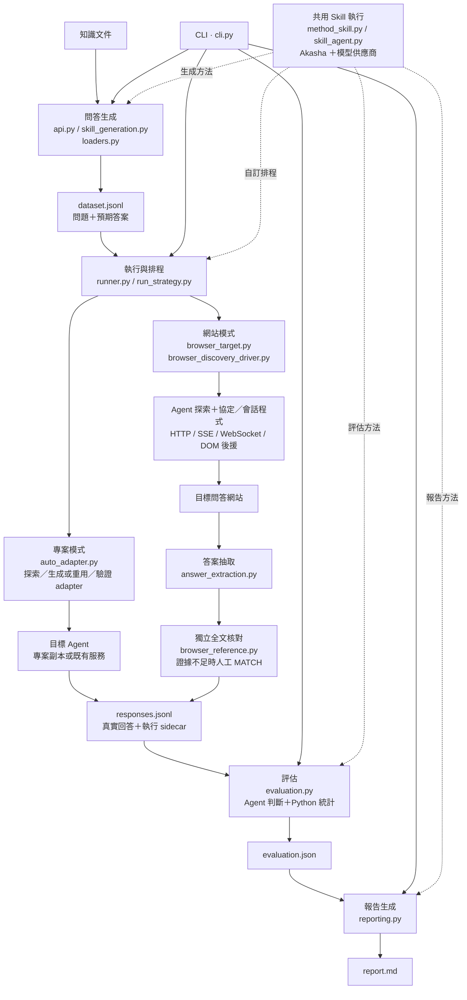

# LLaDAR 架構總覽

主要流程依 2026-10-10 工作目錄的程式碼整理，網站模式依 2026-10-13 現行程式碼更新。Graphify 既有圖譜（2026-10-02）用於定位模組。這是模組與資料流圖，不是完整函式呼叫圖。

實線表示主要資料流或入口派送；虛線表示共用方法支援。

- 問答生成可直接從知識產生 QA；語意圖譜、probe 與受控變體是選用路徑。
- 專案模式與網站模式是不同目標接入方式。網站模式由隔離的 Akasha Agent 探索實際通訊與操作，生成純協定／會話程式，通過候選 probe 與一次獨立驗證後執行；沒有固定網站 selector 或框架選路清單。
- 生成程式在有資源限制的 Monty VM 中執行，僅回傳完整協定材料與操作提案；宿主執行真正的瀏覽器操作、來源檢查與提交前帳本保存。
- 無工具模型抽取回答後另做獨立全文核對。DOM reference 至少經三個可信完整回合資格化，且當回合來源、完成證據與全文仍可驗證時，才自動核對正式回答；證據不足或原始格式無法逐字還原時人工 `MATCH`。
- 內建 run skill 可使用本機確定性 `strategy.py`；自訂 run skill 可交由 Skill Agent 解讀。
- 評估由 Agent 提出方法與判斷，Python 驗證並計算統計。
- 多輪情境另由 `situation.py` 串接情境生成、session 執行與評估；`session_adapter.py` 提供 session adapter，報告共用 `reporting.py`。
- 共用支援包括 `records.py` 的資料驗證與讀寫、`model_profiles.py` 的模型預算，以及 `progress.py` / `command_log.py` 的進度和日誌。

## 程式碼依據

- `src/lladar/cli.py`：派送生成、執行、評估、報告與情境命令。
- `src/lladar/api.py` / `skill_generation.py`：生成入口、知識載入、Skill 工具與候選驗證。
- `src/lladar/runner.py`：專案／網站目標選擇、策略執行與回答保存。
- `src/lladar/browser_target.py`：探索、資格化、共用帳本、正式回合與修復調度。
- `src/lladar/browser_discovery_driver.py`：通用 HTTP／SSE／原生 WebSocket、DOM 結構觀察及宿主操作。
- `src/lladar/browser_agent_loop.py`：可終止的 Akasha worker 與宿主工具／模型扣次 broker。
- `src/lladar/protocol_runtime.py`：能力隔離、資源受限的純協定程式執行。
- `src/lladar/browser_provenance.py` / `browser_reference.py`：當回合來源及完整材料驗證、獨立全文參考與資格化。
- `src/lladar/evaluation.py`：評估計畫、逐筆判斷及統計彙整。
- `src/lladar/reporting.py`：一般及情境報告生成。

## 可用 Skills

| Skill | 用途 |
|---|---|
| graphify | 從程式碼與文件查詢依賴、模組關係和資料流，提供架構圖依據。 |
| codebase-design | 分析模組介面與責任邊界，適合後續架構改善。 |
| visualize:visualize | 建立可互動的架構說明，適合點選探索模組。 |

目前總覽使用 Mermaid，便於隨程式碼修改及版本控制。
