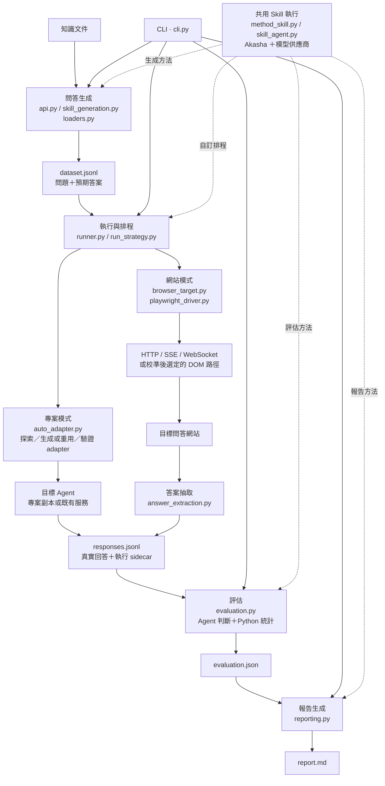

# LLaDAR 架構總覽

依 2026-10-10 工作目錄的程式碼整理。Graphify 既有圖譜（2026-10-02）用於定位模組；近期瀏覽器路徑另以現行程式碼核對。這是模組與資料流圖，不是完整函式呼叫圖。

實線表示主要資料流或入口派送；虛線表示共用方法支援。

- 問答生成可直接從知識產生 QA；語意圖譜、probe 與受控變體是選用路徑。
- 專案模式與網站模式是不同目標接入方式。網站模式先校準，再固定選定路徑執行。
- 內建 run skill 可使用本機確定性 `strategy.py`；自訂 run skill 可交由 Skill Agent 解讀。
- 評估由 Agent 提出方法與判斷，Python 驗證並計算統計。
- 多輪情境另由 `situation.py` 串接情境生成、session 執行與評估；`session_adapter.py` 提供 session adapter，報告共用 `reporting.py`。
- 共用支援包括 `records.py` 的資料驗證與讀寫、`model_profiles.py` 的模型預算，以及 `progress.py` / `command_log.py` 的進度和日誌。

## 程式碼依據

- `src/lladar/cli.py`：派送生成、執行、評估、報告與情境命令。
- `src/lladar/api.py` / `skill_generation.py`：生成入口、知識載入、Skill 工具與候選驗證。
- `src/lladar/runner.py`：專案／網站目標選擇、策略執行與回答保存。
- `src/lladar/playwright_driver.py`：HTTP、WebSocket 及 DOM 校準與執行路徑。
- `src/lladar/evaluation.py`：評估計畫、逐筆判斷及統計彙整。
- `src/lladar/reporting.py`：一般及情境報告生成。

## 可用 Skills

| Skill | 用途 |
|---|---|
| graphify | 從程式碼與文件查詢依賴、模組關係和資料流，提供架構圖依據。 |
| codebase-design | 分析模組介面與責任邊界，適合後續架構改善。 |
| visualize:visualize | 建立可互動的架構說明，適合點選探索模組。 |

目前總覽使用 Mermaid，便於隨程式碼修改及版本控制。
